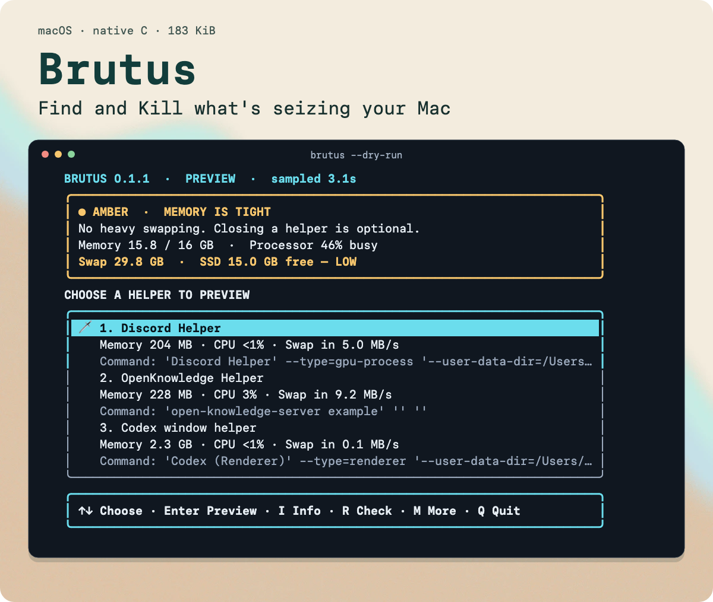

# Brutus

**Find the subprocess seizing your Mac, and choose exactly what to stop.**



<p align="center">
  <a href="#installation"><strong>Installation</strong></a> ·
  <a href="https://github.com/smashah/brutus/releases/latest">Download the release</a> ·
  <a href="docs/how-it-works.md">How it works</a> ·
  <a href="skills/brutus/SKILL.md">Agent skill</a>
</p>

*Captured from the running CLI in preview mode. Local project names and paths are redacted; resource values are real.*

I’m still using a MacBook I bought several years ago, and I want to squeeze every last drop of productivity out of it. With agents working in parallel, that increasingly means keeping a small army of subprocesses from overwhelming the machine.

Each harness can spawn agents, tool calls, build processes, dev servers, and browser helpers. When resource usage goes insane, it’s hard to work out which subprocess belongs to which job. The usual response is to find the biggest number in Activity Monitor or Stats and kill the whole parent process, which interrupts other jobs and leaves you starting them back up.

I wanted a smaller intervention: find the individual subprocess that’s seizing the Mac and stop that one. Where an agent or harness can retry the failed work, it can handle that recovery while the other jobs have a chance to carry on. Brutus targets the PID you choose; the surrounding agent or app handles what happens next.

Brutus samples resource usage for about three seconds and offers the top three individual processes, with their launch commands, memory, and CPU use. RAM, swap, SSD space left, and active memory transfers stay visible. Press **I** for the full command, working folder, and technical details to help recognize the job before stopping it.

## Why “Brutus”?

A process that’s **seizing** your Mac is a **seizer**, which sounds suspiciously like **Caesar**. Hence Brutus: one small, surgical intervention aimed at freeing up the machine while sparing the rest of the workload.

The goal is to get more useful work out of the Mac I already have, with fewer interruptions to the agents working on it.

## Installation

macOS only. The release binary contains Apple silicon and Intel slices and targets macOS 12 or newer. Runtime measurements were taken on Apple silicon; an Intel machine has not been exercised yet.

Install and make `brutus` available immediately:

```sh
curl -fsSL https://raw.githubusercontent.com/smashah/brutus/main/install.sh | sh && export PATH="$HOME/.local/bin:$PATH"
```

The [installer](install.sh) checks the release archive's SHA-256 and installs into `~/.local/bin` without sudo. It saves PATH for future terminals when needed; the `export` makes it available in this terminal immediately. This command works in zsh and bash.

Run `brutus --dry-run` to try every menu action without closing anything, or `brutus` to choose a process to close. Set `BRUTUS_INSTALL_DIR` to choose another directory and use that directory in the `export` too.

Prefer Homebrew?

```sh
brew tap smashah/brutus https://github.com/smashah/brutus
brew install smashah/brutus/brutus
```

Homebrew may ask you to trust the formula. The binary is ad-hoc signed, not Developer ID signed or notarized. You can also [build from source](#build-from-source).

## Choose, inspect, close

| Key | Action |
| --- | --- |
| **↑ / ↓** | Choose an individual process |
| **Enter** | Close the selected process; preview it in `--dry-run` |
| **I** | Show its full command, resource samples, paths, and system details |
| **R** | Take a new sample in the same screen |
| **M** | More commands, including closing all shown processes |
| **Q** | Quit without closing anything |

In the info view, arrows scroll and **I** or **Esc** returns to the list. More commands can show one or three candidates, refresh, or force the selected helper to close.

```sh
brutus                          # Top three, sampled over three intervals
brutus 1                        # Only the top candidate
brutus --dry-run                # Try the menu without sending signals
brutus scan                     # Print a report and exit
brutus inspect 12345            # Details for a specific PID
brutus close 12345              # Close only this PID
brutus close 12345 --force      # TERM, then KILL if it remains after 3 seconds
brutus --json                   # Read-only JSON report
brutus --version
```

## For agents

The small [Brutus skill](skills/brutus/SKILL.md) tells agents when to investigate sustained Mac stalls, how to sample without an interactive menu, and how to target one subprocess within the user's authorization. It doesn't run in the background or automatically close the biggest process.

For Codex, install the reference with:

```sh
mkdir -p ~/.codex/skills/brutus && curl -fsSL https://raw.githubusercontent.com/smashah/brutus/main/skills/brutus/SKILL.md -o ~/.codex/skills/brutus/SKILL.md
```

For other harnesses, put the same `brutus/SKILL.md` in their skills directory.

## What the lights mean

- **Green:** No heavy pressure detected. Closing a helper is optional.
- **Amber:** Memory is tight, transfers or CPU use are elevated, or SSD space is below 20 GiB.
- **Red:** Critical pressure, heavy sustained swapping, CPU nearly full, or less than 5 GiB of SSD space.

Swap used and SSD free space are shown together. Existing swap has already consumed disk space; “SSD free” is the space that remains for files, apps, and further swap growth. A large swap total alone does not make the status red.

The detailed view includes swap in/out, compression, disk throughput, kernel CPU, load averages, total processes, and the three per-process samples. [How the ranking and thresholds work →](docs/how-it-works.md)

## One process at a time

Brutus sends signals only to the PIDs you choose, never to a process group or application tree. It excludes other users' processes, detected main GUI processes, and its own ancestors. Before each signal, it checks the process's owner and native start timestamp again.

The launch command and working folder give you context for identifying a job. Brutus does not automatically attribute every process to a particular subagent or harness.

After a close request, it measures the Mac again and reports before/after pressure, memory, swap, transfers, CPU, process count, and SSD space. A private JSON report is saved under `~/.local/state/brutus/`; launch commands are not saved in these reports. If a process remains, Brutus says so and shows how to force that PID to close.

The candidates are leads, not proof of which process caused a freeze. Closing a subprocess can interrupt its work, its window, or jobs that depend on it. Some agents and apps can retry or restart that work, but recovery depends on your setup; Brutus doesn’t implement it. It does not delete files, clear caches, disable services, or promise instant swap reclamation.

## Small on purpose

The thing helping a struggling Mac should leave room for the work you actually want to do. Brutus is one native C process reading macOS counters directly through libproc, Mach, sysctl, and IOKit, with no interpreter, daemon, telemetry, or helper command. The menu blocks on keyboard input while idle.

The development build measured roughly **2.1 MiB idle / 3.2 MiB peak** physical memory footprint, with **37–66 ms of CPU work** per three-second check. Idle CPU was unmeasurable during a five-second observation. [Measurement details and build identity →](docs/footprint.md)

## Build from source

Requires Apple's Command Line Tools (`xcode-select --install`) and `make`.

```sh
git clone https://github.com/smashah/brutus.git
cd brutus
make
make install
```

Default installation: `~/.local/bin/brutus`. To choose another prefix, use `make install PREFIX=/your/prefix`. To remove it, use the matching `make uninstall PREFIX=/your/prefix`. These commands leave saved reports alone.

## Contributing

For a bug report, include `brutus --version`, macOS version, CPU architecture, the visible symptom, and a screenshot or redacted output. Don't include a full command line if it contains private arguments. Improvements to process labeling, pressure heuristics, and accessibility are welcome.

## License

[MIT](LICENSE).
